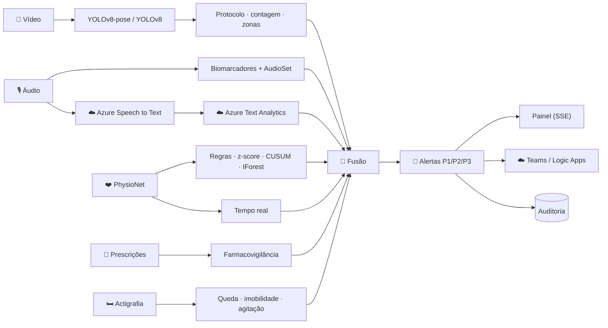

<div align="center">

# 🩺 Monitoramento Multimodal de Pacientes
### Vídeo · Áudio · Texto · Sinais Vitais · Azure Cognitive Services

**Tech Challenge Fase 4 · Pós-Graduação IA Para Desenvolvedores · FIAP**

<p>
  
  
  
  
  
  
</p>

<p>
  <a href="#-vídeo-de-demonstração">
    
  </a>
  <a href="https://tech-challenge-fiap-grupo-02-2026.github.io/tech-challenge-fase4/">
    
  </a>
</p>

</div>

---

## 👥 Equipe

| Nome | E-mail |
|------|--------|
| Wilson Lima da Silva | wilson.slima@gmail.com |
| Gustavo Lopes da Silva | gustavo_lsilva@hotmail.com |
| Felipe Soeiro Lopes | felipesoeiro.contato@outlook.com.br |
| Vinicius Tavares Sousa da Silva | viniciustavares2014@gmail.com |

---

## 📋 Visão Geral

Continuação das Fases 2 e 3: com a IA já apoiando exames, documentos e decisões
clínicas, o hospital passa a **monitorar continuamente os pacientes com dados
multimodais** para identificar sinais precoces de risco. O sistema:

- **Analisa vídeos** de fisioterapia e de cirurgia — pose (YOLOv8-pose, layout
  OpenPose) e objetos/áreas críticas (YOLOv8) — e gera **relatórios automáticos**
  de desvios do protocolo e falhas de procedimento;
- **Processa áudios de consultas** — biomarcadores vocais de **fadiga, disartria e
  dificuldade respiratória**, eventos sonoros rotulados com a ontologia **AudioSet**,
  transcrição com **Azure Speech to Text** e termos críticos + sentimento com
  **Azure Text Analytics** (incl. Text Analytics for Health);
- **Detecta anomalias** em **sinais vitais reais (PhysioNet)**, na **evolução das
  prescrições** e nos **padrões de movimentação** durante a internação — em lote e
  **em tempo real**;
- **Funde tudo** num risco único por paciente, reconhece **síndromes multimodais**
  (suspeita de AVC, insuficiência respiratória, choque, queda, delirium, evento
  medicamentoso) e **alerta a equipe médica** com prioridade e roteamento.

> ⚠️ Sistema de **apoio à decisão**: sugere *acionar protocolos e avaliar*, nunca prescreve.

---

## 🧠 Fluxo Multimodal



Detalhamento em [`docs/architecture.md`](docs/architecture.md) e no
[relatório técnico](reports/relatorio_tecnico.md).

---

## 🗂️ Datasets Utilizados

| Dataset | Origem | Uso no projeto |
|---|---|---|
| **PhysioNet — BIDMC PPG and Respiration** ([physionet.org/content/bidmc](https://physionet.org/content/bidmc/1.0.0/)) | **sugerido no enunciado**, acesso aberto | 53 registros reais de UTI (FC, SpO₂, FR a 1 Hz). 6 mapeados para pacientes (incl. hipoxemia real de 83% no BIDMC 32, taquicardia de 139 bpm no 25); os outros 47 treinam o **Isolation Forest populacional** |
| **Google AudioSet** ([research.google.com/audioset](https://research.google.com/audioset/)) | **sugerido no enunciado** | Ontologia (632 classes) + `eval_segments.csv` → catálogo de 22 classes clinicamente relevantes (tosse, respiração, chiado, arquejo...) com `mid` oficial; rótulo de todo evento acústico; classificador **AST** treinado no AudioSet |
| **ESC-50** ([github.com/karolpiczak/ESC-50](https://github.com/karolpiczak/ESC-50)) | CC BY-NC 3.0 (uso acadêmico) | 8 gravações **reais** de tosse/respiração (classes equivalentes do AudioSet, que não distribui áudio), escolhidas ranqueando os 80 clipes pelo próprio AST |
| Consultas, vídeos, prescrições, actigrafia, PA | **sintéticos com ground truth** | Fala pt-BR real sintetizada (voz Microsoft Maria) + perfis vocais por processamento de sinal; vídeos por modelo cinemático (COCO-17); dados clínicos com semente fixa. Cada anomalia injetada é registrada para avaliação |

> Por que sintéticos? Vídeos/áudios reais de pacientes não podem ser versionados
> (LGPD), e não há dataset público com essas anomalias rotuladas em português.
> O pipeline aceita mídia real: `py -m src.main video --file seu_video.mp4 --exercise abducao_ombro`.

---

## 🤖 Modelos Aplicados por Tipo de Dado

| Dado | Modelo / técnica | Arquivo |
|---|---|---|
| Vídeo — postura | **YOLOv8n-pose** (17 keypoints COCO), convertido para o layout **OpenPose COCO-18**; ângulos articulares, ADM por repetição, assimetria, compensação de tronco, tremor (4–8 Hz), detecção de queda | `src/video/pose.py`, `movement_analysis.py` |
| Vídeo — objetos/áreas críticas | **YOLOv8n** (COCO: tesoura, faca, pessoa) ou pesos *fine-tuned* de instrumental (`--weights`); contagem início × fechamento, instrumento fora do campo estéril, invasão de área estéril | `src/video/objects.py`, `procedure_analysis.py` |
| Áudio — voz | Biomarcadores (F0 por autocorrelação, jitter, shimmer, HNR, taxa de fala, pausas, inclinação de energia, tremor) → scores de **fadiga / disartria / respiratório** | `src/audio/features.py`, `voice_analyzer.py` |
| Áudio — eventos | Detector acústico (tosse explosiva / respiração audível) + **AST `MIT/ast-finetuned-audioset`** | `features.py`, `audioset_classifier.py` |
| Áudio — fala→texto | **Azure Speech to Text** (REST, pt-BR, formato detalhado, WER) | `src/audio/azure_speech.py` |
| Texto | **Azure Text Analytics**: sentimento (opinion mining), frases-chave, **Text Analytics for Health**; léxico clínico pt-BR com negação para severidade | `azure_text_analytics.py`, `clinical_terms.py` |
| Sinais vitais | Regras **NEWS2** com persistência · **z-score robusto** (mediana/MAD 60 s) · **CUSUM** · **Isolation Forest** populacional · monitor **online EWMA** | `src/anomaly/vitals.py`, `src/monitoring/realtime.py` |
| Prescrições | Regras de farmacovigilância (alergia × família, salto de dose, dose máxima, ISMP, duplicidade, suspensão) + **z-score log-dose** | `src/anomaly/prescriptions.py` |
| Movimentação | Queda (impacto + imobilidade), imobilidade > 3 h, agitação noturna (z robusto), **Isolation Forest** de perfis horários | `src/anomaly/movement.py` |
| Fusão | Late fusion (máximo + corroboração ponderada) + regras de **síndromes multimodais** | `src/fusion/multimodal_fusion.py` |

---

## 📊 Resultados

Números reais (`py -m src.main evaluate` → [`reports/avaliacao.md`](reports/avaliacao.md);
`py -m src.main run-all` → [`reports/resultados_execucao.md`](reports/resultados_execucao.md)):

| Avaliação | Resultado |
|---|---|
| Indicadores vocais (perfil injetado × detectado) | **6/6 (100%)** |
| Tosse (episódios) — precisão / recall | **0,80 / 1,00** |
| Respiração audível — precisão / recall | 1,00 / **0,45** (ponto fraco conhecido) |
| Vitais com injeção controlada (5 eventos no BIDMC 02) — lote / tempo real | **100% / 100%**, latência média **5,4 s** |
| Achados esperados — vídeo, prescrições, movimentação, síndromes | **100% de recall, 0 achados inesperados** |
| Paciente controle (PAC-0001) | risco **0,00**, nenhum alerta |

| Paciente | Cenário | Risco | Síndromes detectadas |
|---|---|:-:|---|
| PAC-0001 | Pós-op. colecistectomia (controle) | 0,00 baixo | — |
| PAC-0002 | DPOC — SpO₂ real 83% | 1,00 crítico | Insuficiência respiratória |
| PAC-0003 | AVC — disartria + hemiparesia | 1,00 crítico | **Suspeita de AVC** |
| PAC-0004 | Sepse — taquicardia real + hipotensão | 1,00 crítico | Possível choque · Evento medicamentoso (alergia a penicilina) |
| PAC-0005 | Pneumonia — queda | 1,00 crítico | Queda · Insuf. respiratória · Delirium |
| PAC-0006 | Pós-op. cardíaco | 1,00 crítico | Evento medicamentoso (anticoagulação) + tesoura retida no vídeo |

**Exemplos de anomalias detectadas:**
- 🎥 *"Contagem final de instrumental não confere: 4/6 na mesa — faltam {tesoura, pinça}; detectado: tesoura na área da incisão (possível item retido)"*
- 🎥 *"ADM do ombro esquerdo 75° — 50% do alvo do protocolo (150°)"* · *"QUEDA durante o exercício"*
- 🎙️ *"Disartria detectada na voz (score 0,70)"* + *"Paciente relatou 'boca está torta'"*
- ❤️ *"Saturação de O₂ ↓ fora da faixa segura: 83% por 481 s"* (dado real PhysioNet)
- 💊 *"piperacilina_tazobactam prescrito para paciente com alergia registrada a penicilina"*
- 🛏️ *"Provável QUEDA às 12/10 03:40: impacto de 3,6 g seguido de 30 min de imobilidade"*

---

## ☁️ Integração Azure

Configure em `.env` (modelo em [`.env.example`](.env.example)):

```bash
AZURE_SPEECH_KEY=...            AZURE_SPEECH_REGION=brazilsouth
AZURE_LANGUAGE_KEY=...          AZURE_LANGUAGE_ENDPOINT=https://<recurso>.cognitiveservices.azure.com
ALERT_WEBHOOK_URL=...           # opcional: Teams Incoming Webhook / Azure Logic Apps
```

```bash
python -m src.main azure-check    # testa credenciais e conectividade
```

Sem chave, cada serviço cai automaticamente para o fallback local (transcrição de
referência, léxico clínico) e o resultado informa o `provider` usado — nada é
apresentado como Azure sem ter vindo do Azure.

---

## 💻 Painel da Equipe Médica

Duplo clique em [`iniciar_painel.bat`](iniciar_painel.bat) (Windows) ou
`./iniciar_painel.sh` (Linux/Mac) → `http://127.0.0.1:8766`.

- Lista de pacientes com nível de risco; risco fundido e por modalidade; síndromes com evidências;
- **Monitor em tempo real** (replay PhysioNet via Server-Sent Events) com alertas surgindo ao vivo;
- Abas de vídeo (player + frames anotados), áudio (player + transcrição com termos críticos + indicadores), vitais, prescrições, movimentação;
- Feed de alertas P1/P2/P3 com **reconhecimento** (ack) auditado.

| Endpoint | Método | Descrição |
|---|:-:|---|
| `/api/patients` | GET | pacientes + risco fundido |
| `/api/patient/<id>` | GET | avaliação multimodal completa |
| `/api/patient/<id>/analyze` | POST | reprocessa e emite alertas |
| `/api/stream?patient_id=&speed=` | GET (SSE) | vitais ao vivo + alertas |
| `/api/alerts` · `/api/alerts/<id>/ack` | GET · POST | alertas / reconhecimento |
| `/api/azure/status` | GET | serviços Azure configurados |

---

## 🚀 Instruções de Execução

```bash
python -m venv .venv                 # Windows: py -m venv .venv
.venv\Scripts\activate               # Linux/Mac: source .venv/bin/activate
pip install -r requirements.txt      # suficiente para tudo (exceto YOLO/AST com vídeo real)

# opcional: modelos de deep learning (CPU)
pip install torch torchvision --index-url https://download.pytorch.org/whl/cpu
pip install -r requirements-ml.txt

python -m src.main download-datasets   # PhysioNet + AudioSet + ESC-50 (já versionados no repo)
python -m src.main generate-data       # regenera consultas, vídeos e dados clínicos
python -m src.main run-all             # todos os pacientes → reports/
python -m src.main evaluate            # métricas → reports/avaliacao.md
python -m pytest -q                    # 40 passed
```

### ⚙️ Comandos da CLI

| Comando | Descrição |
|---|---|
| `download-datasets` | Baixa PhysioNet BIDMC, AudioSet (ontologia/segmentos) e ESC-50 |
| `generate-data` | Gera dados clínicos, consultas (áudio) e vídeos com ground truth |
| `video --patient-id ID` / `--file X.mp4 --exercise ...` | Análise de vídeo + relatório automático |
| `audio --patient-id ID [--audioset-model]` | Voz + Azure STT + Text Analytics |
| `vitals` / `prescriptions` / `movement --patient-id ID` | Detecção de anomalias por modalidade |
| `assess --patient-id ID` | Fluxo multimodal completo (fusão + alertas) |
| `run-all` | Todos os pacientes, relatórios em `reports/` |
| `monitor --patient-id ID --speed 20` | Monitor de vitais em tempo real no terminal |
| `serve` | Painel web |
| `azure-check` · `alerts` · `logs` · `evaluate` | Infra, alertas, auditoria e avaliação |

Validação do YOLOv8 real (pose + objetos) em imagens públicas: `python scripts/validate_yolo.py`.

---

## 📁 Estrutura do Projeto

```
tech-challenge-fase4/
├── src/
│   ├── datasets/        # PhysioNet, AudioSet, ESC-50 + geradores (áudio, vídeo, clínicos)
│   ├── video/           # pose (YOLOv8-pose ↔ OpenPose), objetos, fisioterapia, cirurgia, relatório
│   ├── audio/           # biomarcadores, indicadores vocais, Azure STT/Text Analytics, AST
│   ├── anomaly/         # sinais vitais, prescrições, movimentação
│   ├── monitoring/      # monitor em tempo real (streaming)
│   ├── fusion/          # fusão multimodal + síndromes
│   ├── alerts/          # AlertManager (prioridade, dedup, canais, ack)
│   ├── cloud/           # configuração/cliente Azure
│   ├── safety/          # trilha de auditoria
│   ├── webapp/          # painel (backend stdlib + front-end)
│   ├── pipeline.py      # orquestrador por paciente
│   ├── evaluation.py    # métricas contra ground truth
│   └── main.py          # CLI
├── data/                # raw (PhysioNet, AudioSet, ESC-50), audio, video, clinical
├── reports/             # relatório técnico, avaliação, resultados, relatórios de vídeo
├── docs/                # arquitetura, roteiro do vídeo
├── tests/               # 40 testes (pytest)
├── scripts/             # validação YOLOv8 real
├── index.html           # página de apresentação
└── iniciar_painel.bat / .sh
```

---

## 📚 Documentação

| Arquivo | Conteúdo |
|---|---|
| [`reports/relatorio_tecnico.md`](reports/relatorio_tecnico.md) | **Relatório técnico**: fluxo multimodal, modelos por tipo de dado, resultados e exemplos de anomalias |
| [`reports/avaliacao.md`](reports/avaliacao.md) | Métricas de cada detector |
| [`reports/resultados_execucao.md`](reports/resultados_execucao.md) | Achados de todos os pacientes |
| [`docs/architecture.md`](docs/architecture.md) | Arquitetura, contrato `Finding`, integração Azure |
| [`docs/roteiro_video.md`](docs/roteiro_video.md) | Roteiro do vídeo de demonstração |

---

## ▶ Vídeo de Demonstração

Link do YouTube: _a ser adicionado após a gravação_ (roteiro em [`docs/roteiro_video.md`](docs/roteiro_video.md)).

---

## 🐙 Repositório GitHub

[https://github.com/tech-challenge-fiap-GRUPO-02-2026/tech-challenge-fase4](https://github.com/tech-challenge-fiap-GRUPO-02-2026/tech-challenge-fase4)

> Projeto acadêmico com dados abertos/sintéticos — não utilizar em ambiente clínico
> real sem validação institucional e aprovação ética.
