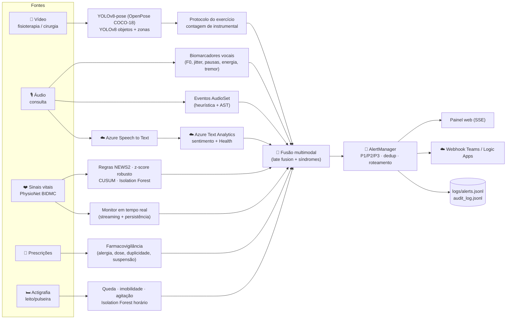

# Arquitetura — Monitoramento Multimodal (Fase 4)

## Fluxo multimodal

## Camadas

| Camada | Módulos | Responsabilidade |
|---|---|---|
| Datasets | `src/datasets/` | PhysioNet BIDMC (download + PA alinhada), AudioSet (ontologia/catálogo clínico), ESC-50 (tosse/respiração reais), geradores de áudio/vídeo/dados clínicos com ground truth |
| Vídeo | `src/video/` | `pose.py` (YOLOv8-pose ↔ OpenPose-18), `objects.py` (YOLOv8 + zonas), `movement_analysis.py` (protocolos de fisioterapia, queda), `procedure_analysis.py` (contagem de instrumental, área estéril), `video_pipeline.py` (relatório automático + frames anotados) |
| Áudio | `src/audio/` | `features.py` (biomarcadores), `voice_analyzer.py` (fadiga/disartria/respiratório), `azure_speech.py`, `azure_text_analytics.py`, `clinical_terms.py` (léxico + negação), `audioset_classifier.py` (AST) |
| Anomalias | `src/anomaly/` | `vitals.py` (4 camadas), `prescriptions.py`, `movement.py` |
| Tempo real | `src/monitoring/realtime.py` | monitor amostra-a-amostra com persistência, rearme, escalonamento e latência |
| Fusão | `src/fusion/multimodal_fusion.py` | risco por modalidade → risco fundido + síndromes multimodais + ação sugerida |
| Alertas | `src/alerts/alert_manager.py` | prioridade P1–P3, deduplicação, canais (console, arquivo, SSE, webhook), reconhecimento |
| Nuvem | `src/cloud/azure_client.py` | credenciais via env/.env, cliente REST mínimo |
| Segurança | `src/safety/audit_logger.py` | trilha de auditoria JSONL |
| Apresentação | `src/webapp/`, `src/main.py` | painel da equipe médica e CLI |

## Contrato comum: `Finding`

Toda modalidade produz `Finding(modality, kind, severity, message, patient_id, time_ref, method, evidence)`.
Isso desacopla detectores de fusão e alertas: um novo detector só precisa emitir `Finding`s.

## Fusão (late fusion)

1. `risco_modalidade = severidade máxima + 0,03 × achados adicionais` (cap 1,0);
2. `risco_fundido = máx(modalidades) + 0,5 × Σ peso·risco das demais + 0,1 × nº de síndromes` (cap 1,0) — **nunca dilui** um achado crítico;
3. Síndromes exigem corroboração entre modalidades distintas (ex.: AVC = disartria/relato **e** assimetria motora/relato neurológico).

## Integração Azure

| Serviço | Endpoint | Uso | Fallback local |
|---|---|---|---|
| Speech to Text | `https://{região}.stt.speech.microsoft.com/speech/recognition/conversation/cognitiveservices/v1?language=pt-BR&format=detailed` | transcrição + confiança; WER vs. referência | transcrição de referência (`.txt`) |
| Language — Sentiment | `POST {endpoint}/language/:analyze-text` `kind=SentimentAnalysis` (opinion mining) | sentimento por frase | léxico pt-BR |
| Language — Key phrases | `kind=KeyPhraseExtraction` | frases-chave | — |
| Text Analytics for Health | `POST {endpoint}/language/analyze-text/jobs` `kind=Healthcare` (assíncrono) | entidades clínicas + negação | léxico clínico com detecção de negação |
| Entrega de alertas | Webhook (Teams / Logic Apps) | P1/P2 para o celular do plantonista | painel + arquivo |

Todo resultado indica o `provider` usado — nunca se apresenta um fallback como se fosse Azure.

## Segurança e limites

- Sistema de **apoio à decisão**: as ações sugeridas acionam protocolos e avaliação humana, nunca prescrevem.
- Alertas com persistência mínima e deduplicação para reduzir fadiga de alarme.
- Auditoria de toda avaliação (scores, providers usados) e de todo alerta (emissão, reconhecimento, falha de webhook).
- Dados de pacientes são sintéticos/abertos (PhysioNet open access); nenhum dado real identificável é versionado.
