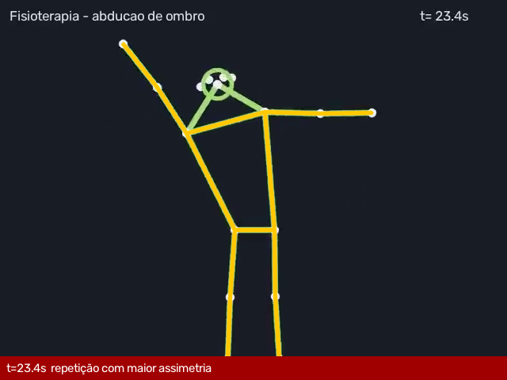

# Relatório automático de vídeo — PAC-0003_fisio_ombro.mp4

- **Paciente:** PAC-0003
- **Tipo:** Abdução de ombro bilateral
- **Fonte de detecção:** keypoints_sidecar (COCO-17)
- **Risco da modalidade:** 0.79

## Métricas

| Métrica | Valor |
|---|---|
| adm_media_esq | 75.3 |
| adm_media_dir | 158.3 |
| assimetria_media | 83.0 |
| inclinacao_tronco_max | 14.6 |
| tremor_esq | 0.322 |
| tremor_dir | 0.1089 |

## Repetições

| rep | adm_esq | adm_dir | assimetria | inclinacao_tronco_max | pico_s |
|---|---|---|---|---|---|
| 1 | 75.5 | 157.8 | 82.3 | 14.4 | 3.57 |
| 2 | 75.3 | 157.6 | 82.3 | 14.0 | 8.63 |
| 3 | 75.7 | 157.7 | 82.0 | 14.2 | 13.53 |
| 4 | 74.9 | 159.1 | 84.2 | 14.2 | 18.47 |
| 5 | 75.2 | 159.5 | 84.4 | 14.6 | 23.43 |

## Desvios / falhas detectados

- **[ALTO]** ADM do ombro esquerdo 75° — 50% do alvo do protocolo (150°) _(em pior repetição em 23.4s)_
- **[ALTO]** Assimetria média de 83° entre os braços (esq 75° × dir 158°) _(em 23.4s)_
- **[MODERADO]** Compensação com inclinação lateral do tronco de até 15° durante a elevação
- **[MODERADO]** Tremor no punho esquerdo (índice 0.322, limite 0.2)

## Frames-chave

> Relatório gerado automaticamente — requer revisão do fisioterapeuta/cirurgião responsável.