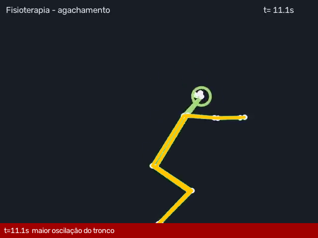
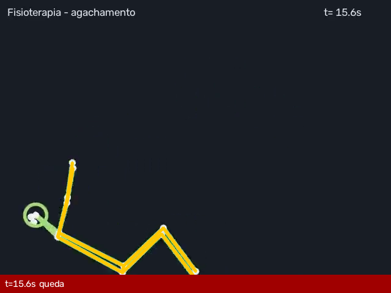

# Relatório automático de vídeo — PAC-0005_fisio_agachamento.mp4

- **Paciente:** PAC-0005
- **Tipo:** Agachamento (sentar-levantar)
- **Fonte de detecção:** keypoints_sidecar (COCO-17)
- **Risco da modalidade:** 0.98

## Métricas

| Métrica | Valor |
|---|---|
| flexao_joelho_media | 100.3 |
| oscilacao_tronco_max | 5.56 |
| queda | True |

## Repetições

| rep | flexao_joelho_max | oscilacao_tronco | pico_s |
|---|---|---|---|
| 1 | 100.9 | 0.94 | 3.03 |
| 2 | 99.7 | 1.01 | 7.07 |
| 3 | 100.2 | 5.56 | 11.07 |

## Desvios / falhas detectados

- **[ALTO]** Oscilação do tronco crescente (até 5.6°, limite 3°) — instabilidade/risco de queda _(em rep 3 em 11.1s)_
- **[CRITICO]** QUEDA durante o exercício: tronco a 60° da vertical, quadril desceu 149px _(em 015.6s)_

## Frames-chave

> Relatório gerado automaticamente — requer revisão do fisioterapeuta/cirurgião responsável.