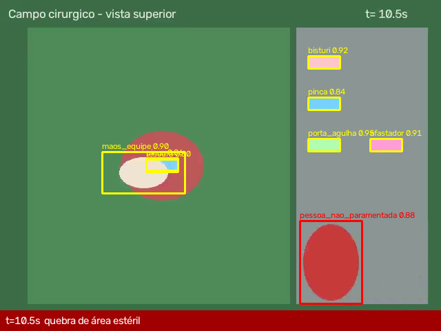
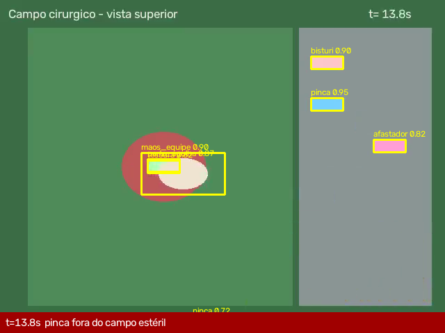
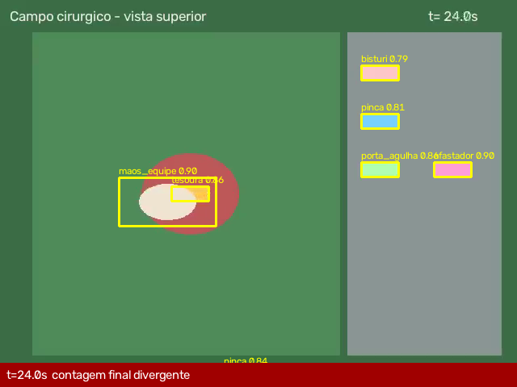

# Relatório automático de vídeo — PAC-0006_cirurgia.mp4

- **Paciente:** PAC-0006
- **Tipo:** cirurgia
- **Fonte de detecção:** detections_sidecar (formato YOLO)
- **Risco da modalidade:** 1.00

## Métricas

| Métrica | Valor |
|---|---|
| duracao_s | 24.0 |
| contagem_inicial | {'bisturi': 1, 'tesoura': 1, 'afastador': 1, 'pinca': 2, 'porta_agulha': 1} |
| contagem_final | {'afastador': 1, 'pinca': 1, 'porta_agulha': 1, 'bisturi': 1} |
| primeira_deteccao_incisao_s | 3.0 |

## Desvios / falhas detectados

- **[CRITICO]** Contagem final de instrumental não confere: 4/6 na mesa — faltam {'tesoura': 1, 'pinca': 1}; detectado(s): tesoura na área da incisão (possível item retido) _(em fechamento (24.0s))_
- **[ALTO]** pinca saiu do campo estéril (provável queda) em 13.3s — considerar contaminado _(em 13.3s)_
- **[ALTO]** Pessoa não paramentada na área estéril entre 9.0s e 12.0s (3.0s) _(em 9.0s–12.0s)_

## Frames-chave

> Relatório gerado automaticamente — requer revisão do fisioterapeuta/cirurgião responsável.